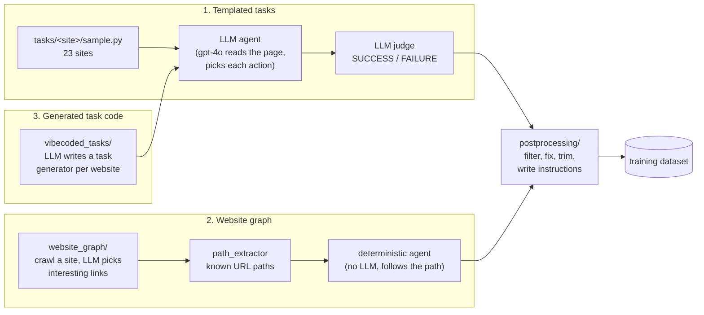

# Web Trajectory Scraper

Generates **training data for web-browsing AI agents**: realistic tasks on real websites, carried
out in a real browser, recorded step by step, and checked for success.

A **trajectory** is one recorded attempt at a task: for every step, a screenshot, the page's
accessibility tree (a text outline of every button, link and field), the action taken (click,
type, scroll, switch tab…) and the URL. Thousands of these make a dataset an agent can learn from.

An illustrative run (element ids like `142` point into that step's accessibility tree):

```
Task: "Find wireless earbuds on Amazon with free shipping and open the top result"

step 1  goto(url='https://www.amazon.com')                screenshot_001.png  axtree_001.txt
step 2  click(bid='142', button='left')   # search box    screenshot_002.png  axtree_002.txt
step 3  keyboard_type(text='wireless earbuds')            screenshot_003.png  axtree_003.txt
step 4  keyboard_press(key='Enter')                       screenshot_004.png  axtree_004.txt
step 5  click(bid='388', button='left')   # Free Shipping screenshot_005.png  axtree_005.txt
step 6  click(bid='512', button='left')   # top result    screenshot_006.png  axtree_006.txt
verdict: SUCCESS
```

## How it works

There are three ways to produce trajectories. They share the same browser environment and
output format.



| Source | How tasks are made | Who acts in the browser | How success is known |
|---|---|---|---|
| **1. Templated tasks** (`tasks/`) | Hand-written templates per site, filled with real data (product keywords, papers, places…) | An LLM agent (`agent/axtree_agent.py`) | An LLM judge looks at the screenshots and answer (`utils/eval_utils/llm_as_judge.py`) |
| **2. Website graph** (`website_graph/`, `deterministic_agent/`) | Crawl a site breadth-first; an LLM picks useful links; every path through the graph becomes a task | A scripted agent that clicks (or hovers to reveal menus) toward the next known URL | Verifiable: the path is known, so success = reaching each URL in order |
| **3. Generated task code** (`vibecoded_tasks/`) | An LLM writes a `tasks_<site>.py` generator for each site in a list of ~600 | Same as source 1 | Same as source 1 |

Instructions are written at three levels of detail, so the same trajectory can teach both
"high-level goal" and "step-by-step" following:

| Level | Example |
|---|---|
| high | Explore Aternos and Reddit to find discussions about player tracking and bans in Minecraft. |
| mid | Visit the Aternos website and then navigate to Reddit to find discussions related to Aternos… |
| low | Start by visiting the Aternos homepage. Then, go to Reddit and search for the 'aternos' subreddit… |

## Websites covered by templated tasks

Amazon · Apple · AllRecipes · arXiv · BBC · Booking.com · Cambridge Dictionary · Coursera ·
ESPN · GitHub · Google Maps · Google Scholar · Google Search · Hugging Face · Merriam-Webster ·
Papers with Code · Semantic Scholar · Satlas · ScholarQA · Wikipedia · Wolfram Alpha

Each `tasks/<site>/sample.py` has a config saying how many of each task type to make, for
example Amazon:

| Task type | Count |
|---|---|
| `find_products_on_amazon_by_keyword_with_free_shipping` | 200 |
| `summarize_product_reviews` | 300 |
| `add_products_to_cart_and_check_cart` | 400 |
| … 10 more types | |

## Setup

Requires Python 3.12+ and [uv](https://docs.astral.sh/uv/).

```bash
uv sync
uv run playwright install --with-deps chromium
```

Browsers run in the cloud on [Browserbase](https://www.browserbase.com/), and the LLM steps use
OpenAI. Set the keys for the parts you use:

| Variable | Needed for |
|---|---|
| `OPENAI_API_KEY` | the LLM agent, the judge, link selection, task and instruction generation |
| `BROWSERBASE_API_KEY`, `BROWSERBASE_PROJECT_ID` | running any browser session |
| `GOOGLE_MAPS_API_KEY` | Google Maps tasks |
| `SERPER_DEV_API_KEY` | Google Search tasks |
| `S2_API_KEY` | Semantic Scholar tasks |
| `WIKIPEDIA_ACCESS_TOKEN` | Wikipedia tasks |
| `HUGGINGFACE_TOKEN` | Hugging Face tasks |
| `GITHUB_TOKEN` | GitHub tasks |

## Quickstart

**Source 1: templated tasks → LLM agent**

```bash
# 1. Sample tasks for one site into a JSON file
uv run -m tasks.amazon.sample --filepath amazon_tasks.json

# 2. Run the agent on them (split across jobs/workers for scale)
uv run -m tasks.generate_trajectories \
  --task_prefix amazon --tasks_json amazon_tasks.json --output_dir out/amazon \
  --num_jobs 1 --job_id 0 --num_workers 4 --max_steps 20
```

**Source 2: website graph → deterministic agent**

```bash
cd website_graph
uv run -m website_explorer https://www.autozone.com --max-depth 2 --depth-max-items "10,3" --output-dir autozone
uv run -m path_extractor autozone          # turns the graph into path tasks
cd ../deterministic_agent
uv run -m det_agent_generate_traj --tasks_json ../website_graph/autozone/<paths>.json \
  --output_dir trajectories/ --num_jobs 1 --job_id 0 --num_workers 2
```

Then clean the output with the steps in
[`deterministic_agent/postprocessing/README.md`](deterministic_agent/postprocessing/README.md):
keep complete runs, convert old formats, trim near-complete runs, fix tab and scroll actions,
add page titles, and generate the three instruction levels.

Each folder has its own README with every option:
[website_graph](website_graph/README.md) ·
[deterministic_agent](deterministic_agent/README.md) ·
[postprocessing](deterministic_agent/postprocessing/README.md) ·
[vibecoded_tasks](vibecoded_tasks/README.md)

## Output

One folder per trajectory:

```
task_amazon_0/
├── trajectory.json      every step: action, URL, open tabs, errors, timestamp
├── metadata.json        task, goal, the three instruction levels, viewport
├── verdict.json         SUCCESS / FAILURE (or path progress) with the reason
├── trajectory.html      a page to scroll through the run visually
├── images/              screenshot_001.png, screenshot_002.png, …
├── axtree/              the accessibility tree seen at each step
└── system_message.md    the prompt the agent was given
```

One step of `trajectory.json`:

```json
"1": {
  "screenshot": "screenshot_001.png",
  "axtree": "axtree_001.txt",
  "other_obs": { "page_index": 0, "url": "https://www.wikipedia.org/",
                 "open_pages_titles": ["Wikipedia"], "open_pages_urls": ["https://www.wikipedia.org/"] },
  "action": { "action_str": "goto(url='https://aternos.org')",
              "action_description": "go to https://aternos.org" },
  "error": null
}
```

## Running at scale

`beaker_scripts/` launches batch jobs on AI2's [Beaker](https://beaker.org) cluster, one folder
per team member. They reference AI2-internal clusters, workspaces and storage paths, so treat them
as examples of how to shard a run (`--num_jobs N --job_id i`) rather than something that runs
elsewhere as-is. The `Dockerfile` builds the image those jobs use.

## Layout

```
agent/                 LLM agent (reads the accessibility tree, outputs one action per step)
tasks/                 task templates per website + the trajectory generators
website_graph/         crawler that maps a site and extracts navigation paths
deterministic_agent/   scripted agent for known paths + postprocessing + train/val split
vibecoded_tasks/       LLM-generated task generators for ~600 more websites
utils/                 Browserbase browser environment, LLM judge, visualisation
beaker_scripts/        batch launch scripts for AI2's Beaker cluster
```

## Known gaps

- `vibecoded_tasks/generate_website_tasks.py` expects a `739_websites.csv` that isn't in the
  repo; pass your own list with `--csv-file` (`website_graph/top_585.txt` has 585 site URLs).
- `utils/vis_utils/vis.py` loads the font from `benchmarks/utils/Arial.ttf`, but the font
  lives at `utils/vis_utils/Arial.ttf`.
- Amazon's sort-by control doesn't work in the browser environment, so Amazon tasks always use
  the default "featured" order.

## Credits

Developed as part of web-agent research at the Allen Institute for AI (AI2), and shared with
AI2's permission. Built on [BrowserGym](https://github.com/ServiceNow/BrowserGym),
[Playwright](https://playwright.dev) and [Browserbase](https://www.browserbase.com/).
